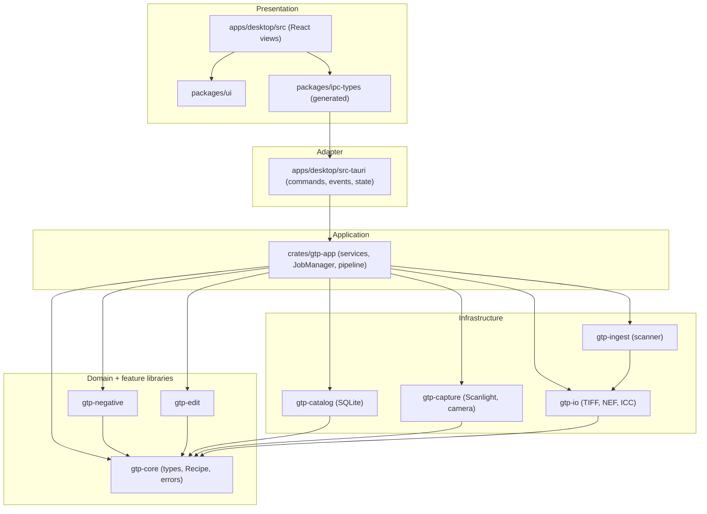
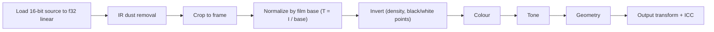
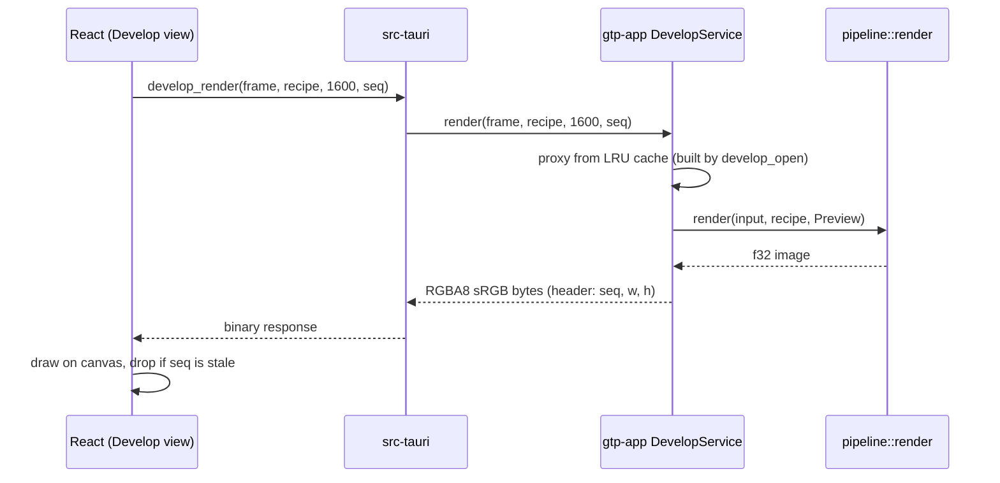
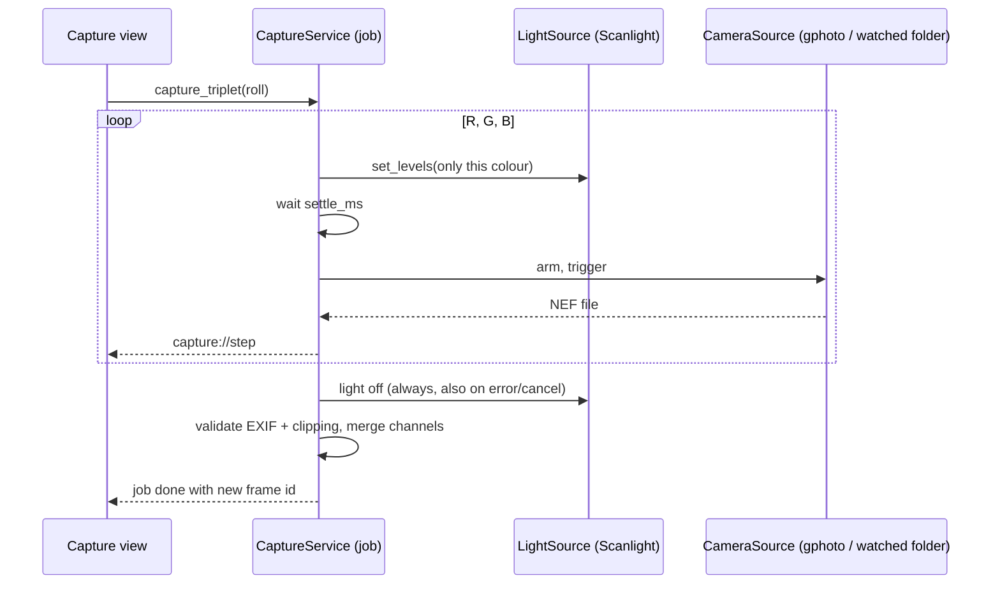

# Introduction: architecture, running locally, extending, troubleshooting

A practical entry point for developers (and AI assistants) new to **Grain to Pixel**. It summarizes [architecture.md](architecture.md) and shows how to work in the repo. For depth, follow the links.

> **Current state (2026-10-29).** The repository holds the scaffold only: docs, seven crate stubs that compile (`gtp-core`, `gtp-io`, `gtp-ingest`, `gtp-capture`, `gtp-negative`, `gtp-edit`, `gtp-catalog`), build tooling for the backlog, and 68 GitHub issues. The desktop app, `gtp-app` and the features do not exist yet. Sections marked **(after X-NN)** describe commands that start working once that issue is done. Code samples are illustrative of the planned design, not existing files.

## 1. What it is

Grain to Pixel is a personal Windows 10/11 and macOS app that scans, converts, edits and organizes film negatives ([idea](product/idea.md)):

1. **Ingest** from a modded Nikon Coolscan LS-50 (RGB + IR, whole rolls) or from R/G/B exposures shot with a Nikon D600 under a Scanlight V4 that the app controls.
2. **Detect** the frame area and **measure** the film base.
3. **Convert** the negative to a positive.
4. **Edit** colour, tone, geometry, and remove dust with the IR plane.
5. **Organize** in a tagged, searchable library and **export**.

Non-goals: masking, AI generation, advanced retouching. Success: results comparable to Nikon Scan 4 / Trichroma Lab ([specification §1](specification.md)).

## 2. Architecture in five minutes

**Stack:** Tauri 2 shell, Rust workspace for all logic, React + TypeScript UI, SQLite catalog. Rationale: [architecture §1](architecture.md).

### 2.1 Layers



Key rules ([architecture §2](architecture.md), [convention §3](convention.md)):

- Dependencies point inward. Feature crates **never depend on each other**; only `gtp-app` combines them. `tools/scripts/check-deps` enforces the edge table in [architecture §3.3](architecture.md).
- `src-tauri` is a thin adapter: validate, call a `gtp-app` service, map errors to `AppError`.
- **Rust owns the pixels.** The UI sends a `Recipe` and receives rendered bytes.
- **Originals are immutable;** every edit is a parameter in the versioned `Recipe`.
- Anything long (scan, import, export, capture) is a **job** with progress events and cancel.
- Hardware sits behind traits with fakes (`ScannerSource`, `LightSource`, `CameraSource`), so everything is testable without devices.

### 2.2 The processing pipeline



The order is fixed ([specification §4.2](specification.md), [rules/colour-pipeline.md](../rules/colour-pipeline.md)). The same `render` function serves the interactive preview (1600/2048 px proxy) and the full-resolution export.

### 2.3 Interactive editing flow



### 2.4 Guided RGB capture flow



### 2.5 Where the data lives

```
<Library>/                       chosen by the user, backed up by copying the folder
├─ library.db                    SQLite (WAL), migrations in crates/gtp-catalog/migrations
├─ originals/<roll>/<frame>/     immutable 16-bit TIFFs (scan.tif + ir.tif, or r.tif g.tif b.tif)
├─ thumbs/<frame>.jpg            rebuildable cache
└─ exports/
```

Details: [specification §5](specification.md). App-level settings (last library, flags, capture profile) live in `settings.json` in the OS config directory.

### 2.6 Core types (planned)

```rust
// crates/gtp-core: the shared language of the app
pub struct ImageF32 { pub width: u32, pub height: u32, pub channels: u8, pub data: Vec<f32> } // linear, row-major

pub struct Recipe {                 // versioned JSON stored per frame
    pub v: u32,
    pub geometry: Geometry, pub base: Base, pub invert: Invert,
    pub color: Color, pub tone: Tone, pub dust: Dust, pub output: Output,
}

pub struct AppError { pub code: ErrorCode, pub message: String, pub details: Option<String> }
```

```jsonc
// a stored recipe (spec §4.1); unknown fields are ignored, missing ones default
{ "v": 1,
  "geometry": { "crop": {"x":0,"y":0,"w":1,"h":1}, "angle_deg": 0, "rot90": 0 },
  "base": { "source": "roll" },
  "color": { "temperature": 0, "tint": 0, "saturation": 1.0 },
  "tone": { "exposure_ev": 0, "contrast": 0 },
  "dust": { "enabled": true, "threshold": 0.5, "grow_px": 2 } }
```

## 3. Key files

| Need | File |
|---|---|
| Product idea | [product/idea.md](product/idea.md) |
| Design, data model, budgets, API | [specification.md](specification.md) |
| Layers, crate API, prompts per step | [architecture.md](architecture.md) |
| Repository layout | [structure.md](structure.md) |
| Code rules, CI gates, commits | [convention.md](convention.md) |
| How the AI works issue by issue | [workflow.md](workflow.md) |
| Backlog (68 issues, prompts, JSON) | [issues.md](issues.md), [issues_upload_instructions.md](issues_upload_instructions.md) |
| Decisions | [decisions/](../decisions/README.md) (ADRs 0001 to 0005) |
| Hardware research notes | [research/nkscan.md](research/nkscan.md), [research/scanlight-capture.md](research/scanlight-capture.md) |
| Colour maths invariants | [rules/colour-pipeline.md](../rules/colour-pipeline.md) |
| Crate responsibilities | [crates/README.md](../crates/README.md) |
| Backlog tooling | [tools/scripts/issues/](../tools/scripts/issues/build-issues.mjs), [tools/scripts/github/upload-issues.ps1](../tools/scripts/github/upload-issues.ps1) |

## 4. Running locally

### 4.1 Prerequisites

| Tool | Windows | macOS (Apple Silicon) |
|---|---|---|
| Rust (stable) | `winget install Rustlang.Rustup`, then `rustup default stable` | `curl https://sh.rustup.rs -sSf \| sh` |
| Node 20 | `winget install OpenJS.NodeJS.LTS` | `brew install node@20` |
| pnpm 9 | `npm i -g pnpm` | `npm i -g pnpm` |
| Git + Git LFS | `winget install Git.Git` (LFS included) | `brew install git git-lfs` |
| GitHub CLI | `winget install GitHub.cli` | `brew install gh` |
| Tauri prerequisites | Visual Studio Build Tools ("Desktop development with C++"), WebView2 (preinstalled on Windows 11) | Xcode command line tools: `xcode-select --install` |

Optional hardware: LS-50 (with the SA-30 firmware mod), Scanlight V4 on USB, Nikon D600. Everything also runs with fakes.

### 4.2 What works today

```bash
cargo check --workspace                        # the crate stubs compile
cargo test --workspace
node tools/scripts/issues/build-issues.mjs --check   # validates the backlog source
```

### 4.3 As the backlog lands

| Command | Works after |
|---|---|
| `git init -b main && git lfs install` | [T-01](issues.md) |
| `cargo fmt --check`, `cargo clippy --workspace --all-targets -- -D warnings`, `cargo deny check`, `pnpm lint`, `pnpm typecheck` | T-02 |
| `pnpm install` then `pnpm dev` (opens the Tauri window) | D-01 |
| `pnpm gen:ipc` (regenerate `packages/ipc-types`) | D-02 |
| CI on every PR (Windows + macOS) | T-03, T-04 |
| `GTP_FAKE_HW=1 pnpm dev` (fixture scanner, fake Scanlight and camera) | H-01, D-04 |
| `cargo run -p benchmark -- golden` (golden images), `-- reference --set <dir>` | Q-01, Q-02 |
| `pnpm tauri build` (installers) | T-05 |

Tests by level: Rust unit tests per crate, golden-image tests, service tests with fakes, Vitest component tests, WebDriver end-to-end on Windows ([specification §8](specification.md)).

### 4.4 Working on an issue

Open the issue on GitHub, expand **Show prompt**, paste it into the AI assistant; it posts a proposal and waits for your approval ([workflow.md](workflow.md)). Do not read all of `docs/issues.md` (it is about 800 KB); grep for the ID you need.

## 5. Adding a new module

First decide what you are adding, then follow the matching recipe. Anything that changes structure or adds a dependency needs an ADR ([decisions/0000-template.md](../decisions/0000-template.md)) and an approved issue ([workflow §4](workflow.md)).

### 5.1 A new pipeline stage or Recipe field

1. **Stage function** in the right crate (`gtp-edit` for creative/corrective, `gtp-negative` for negative maths): a pure function over `ImageF32`.

   ```rust
   // crates/gtp-edit/src/vignette.rs  (illustrative)
   use gtp_core::{ImageF32, Vignette};

   /// Brightens corners by `v.amount` (linear light), in place.
   pub fn apply_vignette(img: &mut ImageF32, v: &Vignette) {
       if v.amount == 0.0 { return; }
       // ... per-row loop, no allocation inside the pixel loop
   }

   #[cfg(test)]
   mod tests {
       use super::*;
       #[test]
       fn zero_amount_is_identity() {
           let mut img = gtp_core::testing::synthetic::flat(8, 8, 0.5);
           let before = img.data.clone();
           apply_vignette(&mut img, &Vignette { amount: 0.0 });
           assert_eq!(img.data, before);
       }
   }
   ```
2. **Recipe field** in `gtp-core/src/recipe` with a default, a clamp and a test; bump `v` and add a `migrate` step only if the shape breaks old data ([architecture §4](architecture.md)).
3. **Wire it** into `gtp-app/src/pipeline/stages.rs` at the correct fixed position (and update the stage-order test and [rules/colour-pipeline.md](../rules/colour-pipeline.md)).
4. **UI:** a panel under `apps/desktop/src/features/develop/panels/` using `Slider` from `packages/ui`; strings through `t()`.
5. **Tests:** unit + golden image; note the performance impact against [specification §11](specification.md).

### 5.2 A new Tauri command (backend feature)

```rust
// 1. crates/gtp-app/src/services/roll_frame.rs  (illustrative)
pub fn roll_stats(&self, id: RollId) -> Result<RollStats, AppError> {
    let rolls = self.ctx.catalog()?;
    rolls.count_frames(id).map(|n| RollStats { frames: n })
}

// 2. apps/desktop/src-tauri/src/commands/roll.rs  (thin: parse, delegate, map errors)
#[tauri::command]
#[specta::specta]
pub async fn roll_stats(state: State<'_, AppState>, id: RollId) -> Result<RollStats, AppError> {
    state.app.roll_frame().roll_stats(id)
}
```

```ts
// 3. after `pnpm gen:ipc`, only the typed wrapper is used in the UI
import { commands } from '@gtp/ipc-types';
const stats = await commands.rollStats(rollId);
```

Checklist: service test with a temp library, command-layer error mapping test, register the command, regenerate and commit `packages/ipc-types` (CI fails on a stale diff), validate inputs at the boundary ([convention §4](convention.md)).

### 5.3 A new database change

Add `crates/gtp-catalog/migrations/000N_<name>.sql` (forward-only), register it, and test migrate-from-empty plus upgrade-from-previous. Never edit an applied migration.

```sql
-- crates/gtp-catalog/migrations/0004_example.sql (illustrative)
ALTER TABLE frame ADD COLUMN example_flag INTEGER NOT NULL DEFAULT 0;
```

The library backs up `library.db` before migrating and refuses to write to a newer schema ([specification §5.3](specification.md)).

### 5.4 A new hardware adapter

Implement the existing trait, add or extend the fake, and keep it behind a Cargo feature if it is platform-specific.

```rust
// crates/gtp-capture/src/my_camera.rs  (illustrative)
impl CameraSource for MyCamera {
    fn arm(&mut self) -> Result<()> { /* ready for one exposure */ Ok(()) }
    fn trigger(&mut self, light: &mut dyn LightSource) -> Result<()> { light.shutter_pulse(10) }
    fn wait_for_image(&mut self, timeout: Duration) -> Result<CapturedFile> { /* poll or block */ todo!() }
}
```

Required: trait-conformance tests shared with `FakeCamera`, light-off on every exit path, and a manual hardware checklist in `docs/research/` (the assistant never ticks `needs:hw` items).

### 5.5 A new crate

1. `crates/gtp-<name>/{Cargo.toml, src/lib.rs}` with `[lints] workspace = true`, `#![forbid(unsafe_code)]` and a `//!` header stating its single responsibility.
2. Add its allowed dependencies to the edge table in [architecture §3.3](architecture.md) and to `tools/scripts/check-deps`; feature crates still depend only on `gtp-core`/`gtp-io`.
3. Add rows to [crates/README.md](../crates/README.md) and [structure.md](structure.md).
4. A new layer or a rule exception needs an ADR first (see [ADR 0005](../decisions/0005-application-layer.md) for an example).

## 6. Troubleshooting

### 6.1 Setup and tooling

| Symptom | Likely cause and fix |
|---|---|
| `git`, `gh` or `pnpm` "not recognized" right after installing | The current terminal predates the install. Open a new terminal. Paths: `C:\Program Files\Git\cmd`, `C:\Program Files\GitHub CLI`. |
| `error: linker 'link.exe' not found` (Windows) | Install Visual Studio Build Tools with "Desktop development with C++". |
| Tauri window is blank or WebView2 error (Windows) | Install the WebView2 runtime; reinstall if corrupted. |
| `xcrun: error` or missing compiler (macOS) | `xcode-select --install`. |
| `cargo clippy` fails on `unwrap_used`, `print_stdout`, `dbg_macro` | The workspace denies them ([convention §1, §6](convention.md)). Use `?`, typed errors and `tracing`. |
| `cargo deny check` fails | New dependency with a disallowed licence or advisory; justify or replace it in the PR. |
| `.tif`/`.nef` fixtures are tiny text files | LFS pointers. Run `git lfs install` then `git lfs pull`. |

### 6.2 Repo checks

| Symptom | Fix |
|---|---|
| `check-deps` reports a forbidden edge | A feature crate depends on another one. Move the composition into `gtp-app` ([architecture §3.3](architecture.md)). |
| CI says ipc-types are stale | Run `pnpm gen:ipc` and commit `packages/ipc-types`. |
| `build-issues.mjs` validation error | A dependency points to an unknown or later-milestone issue; fix `issues.src.txt` ([issues upload instructions](issues_upload_instructions.md)). |
| Upload script stops half-way | Rerun it; existing `ID –` issues are skipped. |
| A golden-image test fails | Inspect the diff; only run the explicit bless command if the change is intended and reviewed. |

### 6.3 Hardware (details to be confirmed by the spikes R-01 to R-04)

| Symptom | Where to look |
|---|---|
| LS-50 not detected | USB driver on Windows (VueScan's driver is needed for the firmware flasher; nkscan may need WinUSB), cable, power; [research/nkscan.md](research/nkscan.md). |
| Only 6 frames scan from the roll | The SA-30 firmware mod is not active or nkscan cannot advance the roll adapter; see the [coolscan-mods](https://github.com/kosma/coolscan-mods) notes and R-01. |
| Scanlight port not found | The device is a USB serial (CDC) port with no fixed VID/PID; the app probes ports with `GET_FW_VERSION`. Check the cable and that no other app (its web app) holds the port. |
| Light stays on after a crash | The app turns it off on exit; use the Scanlight switch if the process was killed. This is why light-off is tested on every exit path. |
| macOS cannot open the camera over USB | The OS camera service may hold the device; this is the known risk tested in R-03. Fall back to the watched-folder backend. |
| No NEF appears in the watched folder (Windows) | digiCamControl must download only (not trigger); confirm the session folder and the pulse length in the capture profile; R-04. |
| NEF fails to decode | Check `rawler` support for the file (R-05); LibRaw is the fallback. |

### 6.4 At runtime

| Symptom | Fix |
|---|---|
| Something crashed | The next launch reports it; use **Settings, Export diagnostics** (zip of logs, versions, schema, counters, no images) ([specification §12](specification.md)). Logs are rotated daily under the OS log directory. |
| Library will not open: "newer version" | The library was written by a newer app. Update the app; it opens read-only meanwhile. |
| Missing or corrupt originals | Run **Verify library**; restore the files from your folder backup. |
| Preview feels slow | Check the dev overlay (flag `dev_overlay`) for stage timings against the budgets in [specification §11](specification.md). |
| Windows SmartScreen / macOS Gatekeeper warning on install | Expected for unsigned builds: "More info, Run anyway" on Windows; right-click, Open on macOS ([specification §9](specification.md)). |

## 7. Where to go next

1. Skim [architecture.md §3](architecture.md) and [convention.md](convention.md).
2. Read [workflow.md](workflow.md): it defines when the AI asks and when it acts.
3. Pick the next issue from the milestone (M0 first) and start with its prompt.
